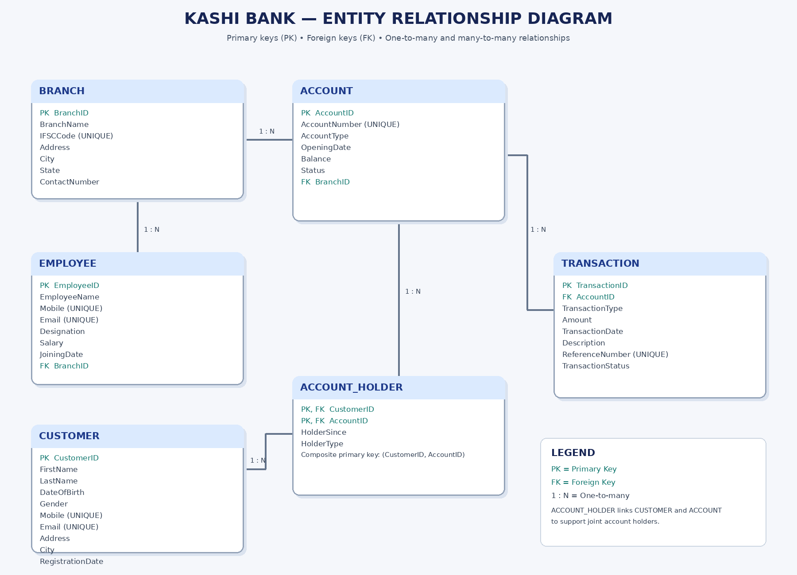

# Project Kashi - Banking Management System

## 1. Overview
Project Kashi is a database-driven web application that simulates basic banking operations.
Tech stack: HTML (frontend), Flask/Python (backend), MySQL (database).

## 2. Workflow (three layers)
HTML form -> Flask route (validates, calls SQL) -> MySQL (stores data, enforces rules)

Example, deposit: user enters account number and amount -> Flask calls `sp_deposit` ->
MySQL inserts a row in TRANSACTION and updates ACCOUNT.Balance in one transaction.

## 3. ER Diagram

## 4. Relationships and Cardinality
| Relationship | Cardinality | Explanation |
|---|---|---|
| BRANCH - EMPLOYEE | 1:N | One branch has many employees; each employee works at one branch |
| BRANCH - ACCOUNT | 1:N | One branch holds many accounts; each account belongs to one branch |
| CUSTOMER - ACCOUNT | M:N | Resolved through ACCOUNT_HOLDER (supports joint accounts) |
| CUSTOMER - ACCOUNT_HOLDER | 1:N | One customer appears in many holder rows |
| ACCOUNT - ACCOUNT_HOLDER | 1:N | One account appears in many holder rows |
| ACCOUNT - TRANSACTION | 1:N | One account has many transactions |

LOAN and LOAN_PAYMENT were skipped, as allowed by the project brief.

## 5. Table Definitions

### BRANCH
| Column | Data Type | Constraint |
|---|---|---|
| BranchID | INT | PRIMARY KEY, AUTO_INCREMENT |
| BranchName | VARCHAR(100) | NOT NULL |
| IFSCCode | VARCHAR(11) | NOT NULL, UNIQUE |
| Address | VARCHAR(255) | |
| City | VARCHAR(50) | |
| State | VARCHAR(50) | |
| ContactNumber | VARCHAR(15) | |

### CUSTOMER
| Column | Data Type | Constraint |
|---|---|---|
| CustomerID | INT | PRIMARY KEY, AUTO_INCREMENT |
| FirstName | VARCHAR(50) | NOT NULL |
| LastName | VARCHAR(50) | |
| DateOfBirth | DATE | NOT NULL |
| Gender | ENUM('Male','Female','Other') | |
| Mobile | VARCHAR(15) | NOT NULL, UNIQUE |
| Email | VARCHAR(100) | UNIQUE |
| Address | VARCHAR(255) | |
| City | VARCHAR(50) | |
| RegistrationDate | DATE | NOT NULL, DEFAULT current date |

### EMPLOYEE
| Column | Data Type | Constraint |
|---|---|---|
| EmployeeID | INT | PRIMARY KEY, AUTO_INCREMENT |
| EmployeeName | VARCHAR(100) | NOT NULL |
| Mobile | VARCHAR(15) | UNIQUE |
| Email | VARCHAR(100) | UNIQUE |
| Designation | VARCHAR(50) | |
| Salary | DECIMAL(10,2) | CHECK (Salary > 0) |
| JoiningDate | DATE | |
| BranchID | INT | NOT NULL, FOREIGN KEY -> BRANCH(BranchID) |

### ACCOUNT
| Column | Data Type | Constraint |
|---|---|---|
| AccountID | INT | PRIMARY KEY, AUTO_INCREMENT |
| AccountNumber | VARCHAR(20) | NOT NULL, UNIQUE |
| AccountType | ENUM('Saving','Current','Salary') | NOT NULL |
| OpeningDate | DATE | NOT NULL, DEFAULT current date |
| Balance | DECIMAL(15,2) | NOT NULL, DEFAULT 0, CHECK (Balance >= 0) |
| Status | ENUM('Active','Inactive','Close') | NOT NULL, DEFAULT 'Active' |
| BranchID | INT | NOT NULL, FOREIGN KEY -> BRANCH(BranchID) |

### ACCOUNT_HOLDER
| Column | Data Type | Constraint |
|---|---|---|
| CustomerID | INT | PRIMARY KEY (composite), FOREIGN KEY -> CUSTOMER |
| AccountID | INT | PRIMARY KEY (composite), FOREIGN KEY -> ACCOUNT |
| HolderSince | DATE | NOT NULL, DEFAULT current date |
| HolderType | ENUM('Primary','Joint') | NOT NULL, DEFAULT 'Primary' |

### TRANSACTION
| Column | Data Type | Constraint |
|---|---|---|
| TransactionID | INT | PRIMARY KEY, AUTO_INCREMENT |
| AccountID | INT | NOT NULL, FOREIGN KEY -> ACCOUNT(AccountID) |
| TransactionType | ENUM('DEPOSIT','WITHDRAWAL','TRANSFER_IN','TRANSFER_OUT') | NOT NULL |
| Amount | DECIMAL(15,2) | NOT NULL, CHECK (Amount > 0) |
| TransactionDate | DATETIME | NOT NULL, DEFAULT CURRENT_TIMESTAMP |
| Description | VARCHAR(255) | |
| ReferenceNumber | VARCHAR(30) | UNIQUE |
| TransactionStatus | ENUM('Success','Failed','Pending') | NOT NULL, DEFAULT 'Success' |

## 6. Key Terms (Definitions)

- **Primary Key:** a column (or set of columns) that uniquely identifies each row. It cannot be NULL or duplicate.
- **Composite Primary Key:** a primary key made of two or more columns, e.g. (CustomerID, AccountID) in ACCOUNT_HOLDER.
- **Foreign Key:** a column that refers to the primary key of another table, linking the two tables and keeping data consistent.
- **Constraint:** a rule on a column, such as NOT NULL, UNIQUE, CHECK, DEFAULT.
- **Normalization:** organizing data into separate tables to remove redundancy. Customer details are stored once in CUSTOMER, not repeated in every account or transaction. The design follows 3NF.
- **Join:** combines rows from two or more tables using a related column.
- **View:** a saved query that behaves like a virtual table and stores no data itself.
- **Stored Procedure:** a named block of SQL stored in the database and run with CALL. It can change data.
- **Stored Function:** like a procedure, but returns a single value and can be used inside SELECT.
- **Trigger:** code that runs automatically before or after INSERT, UPDATE, or DELETE on a table.
- **Transaction:** a group of SQL steps that either all succeed (COMMIT) or all fail (ROLLBACK). It follows ACID: Atomicity, Consistency, Isolation, Durability.
- **Cardinality:** how many rows of one table can relate to rows of another (1:1, 1:N, M:N).

## 7. SQL Queries (10 Business Problems)

| No. | Business Problem | Concepts Used |
|---|---|---|
| Q1 | List all customers with their account numbers and holder type | JOIN (3 tables) |
| Q2 | Total balance held at each branch | JOIN, GROUP BY, SUM |
| Q3 | Customers who hold more than one account | GROUP BY, HAVING |
| Q4 | Accounts with balance above 30000, highest first | WHERE, ORDER BY |
| Q5 | Transaction history of account KASH100001 | JOIN, ORDER BY |
| Q6 | Total deposits and withdrawals per account | LEFT JOIN, CASE, SUM |
| Q7 | Number of employees in each branch | LEFT JOIN, COUNT |
| Q8 | Customers whose accounts have no transactions | Subquery, NOT IN |
| Q9 | Highest-paid employee in each branch | Correlated subquery, MAX |
| Q10 | Inactive accounts with holder names | JOIN, WHERE |

The full SQL for each query is in `database/10_business_querry.sql`.

## 8. Views

| View | Purpose |
|---|---|
| vw_customer_accounts | Shows each customer with their account number, type, balance, status and branch name |
| vw_branch_summary | Shows each branch with its total number of accounts and total balance |

Views hide the complexity of multi-table joins. Code is in `database/sql_view.sql`.

## 9. Stored Functions

| Function | Input | Returns |
|---|---|---|
| fn_get_balance(account_number) | Account number | Current balance of that account |
| fn_customer_total_balance(customer_id) | Customer ID | Sum of balances across all accounts of that customer |

Example: `SELECT fn_get_balance('KASH100001');`

## 10. Stored Procedures

| Procedure | Purpose | Key Logic |
|---|---|---|
| sp_deposit | Deposit money | Validates amount, locks row with FOR UPDATE, inserts TRANSACTION, increases Balance, COMMIT |
| sp_withdraw | Withdraw money | Checks sufficient balance, inserts TRANSACTION, decreases Balance |
| sp_transfer | Transfer between accounts | Debits one account, credits the other, writes two TRANSACTION rows (TRANSFER_OUT and TRANSFER_IN) in one transaction |
| sp_open_account | Open new account | Inserts CUSTOMER, ACCOUNT, ACCOUNT_HOLDER and initial deposit in one transaction; returns the new account number |

All procedures use `START TRANSACTION`, `COMMIT`, and an exit handler that runs `ROLLBACK` on any error, so a failure leaves no partial data.

## 11. Triggers

| Trigger | Event | Purpose |
|---|---|---|
| trg_customer_age_check | BEFORE INSERT on CUSTOMER | Rejects customers younger than 18 |
| trg_block_inactive_account | BEFORE INSERT on TRANSACTION | Rejects transactions on accounts that are not Active |

Code for functions, procedures and triggers is in `database/fuctions_triggers_procedures.sql`.

## 12. Application Pages

| Page | URL | Purpose | Database Action |
|---|---|---|---|
| Home | / | Links to all features | None |
| Open Account | /open-account | Register customer and create account | CALL sp_open_account |
| Deposit | /deposit | Add money | CALL sp_deposit |
| Withdraw | /withdraw | Remove money | CALL sp_withdraw |
| Transfer | /transfer | Move money between accounts | CALL sp_transfer |
| History | /history | View transactions of an account | SELECT with JOIN |

## 13. Security and Integrity Measures

- Parameterized queries (`%s`) in Flask prevent SQL injection.
- Database password is kept in `config.py`, which is excluded from GitHub by `.gitignore`.
- CHECK, UNIQUE, NOT NULL and foreign key constraints protect data integrity.
- Triggers and transactions enforce business rules inside the database.

## 14. Screenshots

Take these and save them in `docs/screenshots/`, then add them here:

1. Workbench: `SHOW TABLES` result
2. Workbench: output of Q2, Q3, and Q8
3. Workbench: `SELECT * FROM vw_customer_accounts`
4. Web: Home page
5. Web: Open Account form, and the success message with the account number
6. Workbench: the new customer row in CUSTOMER
7. Web: Deposit, Withdraw, and Transfer success messages
8. Web: error "Insufficient balance" and "Account is not active"
9. Web: History page showing a table
10. Workbench: ACCOUNT balances before and after a transfer

Insert each one with: ``

## 15. Limitations and Future Scope

- LOAN and LOAN_PAYMENT tables were skipped, as permitted by the brief.
- No login or authentication, and no CSS styling.
- Future work: loan module, user login, interest calculation, monthly statements.